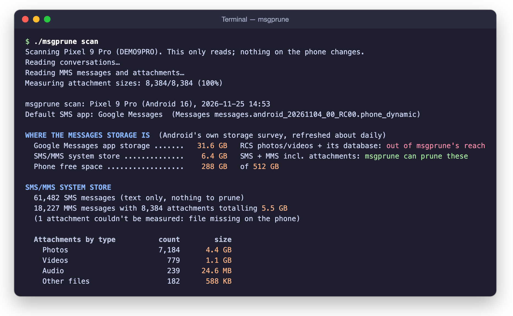
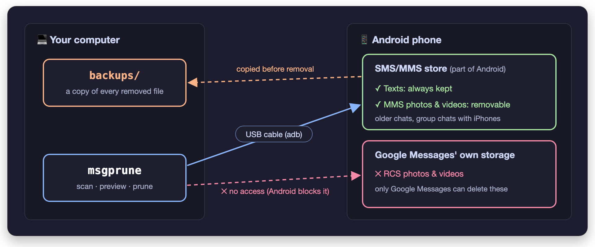
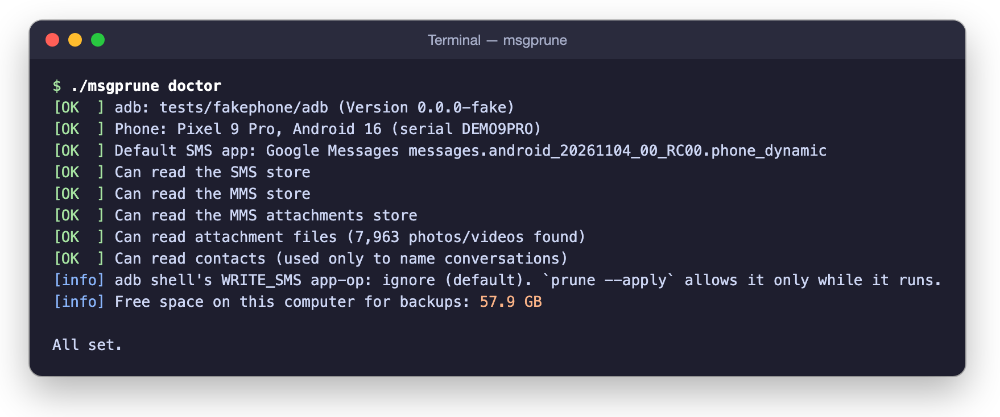
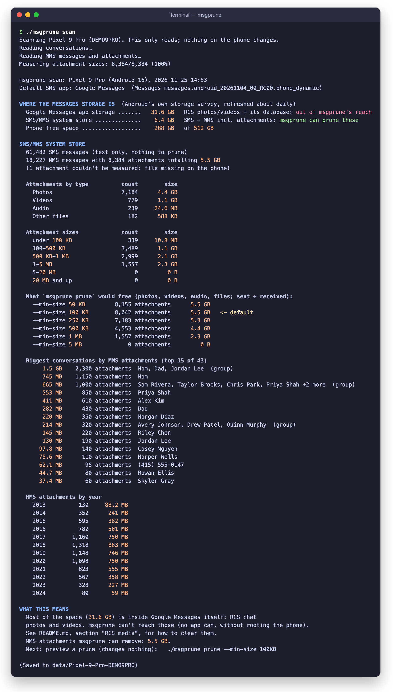
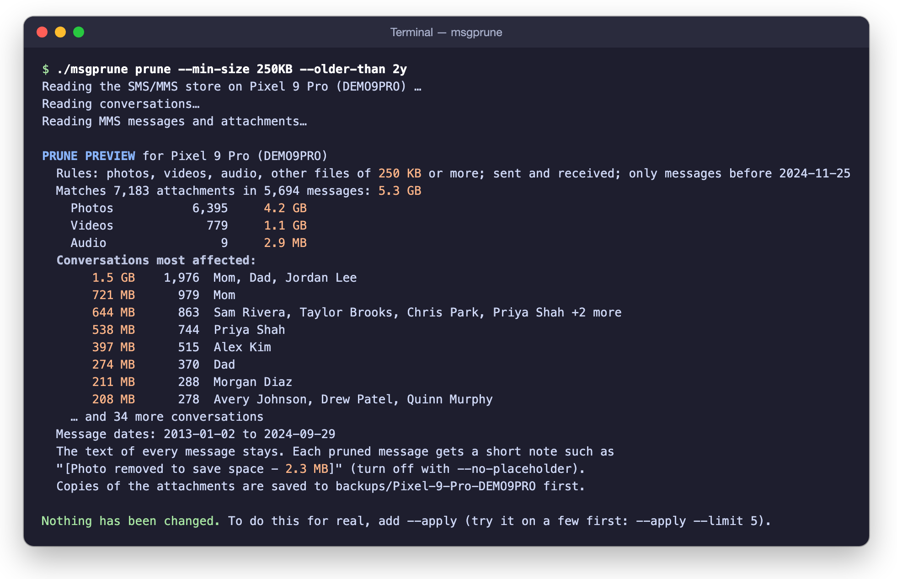
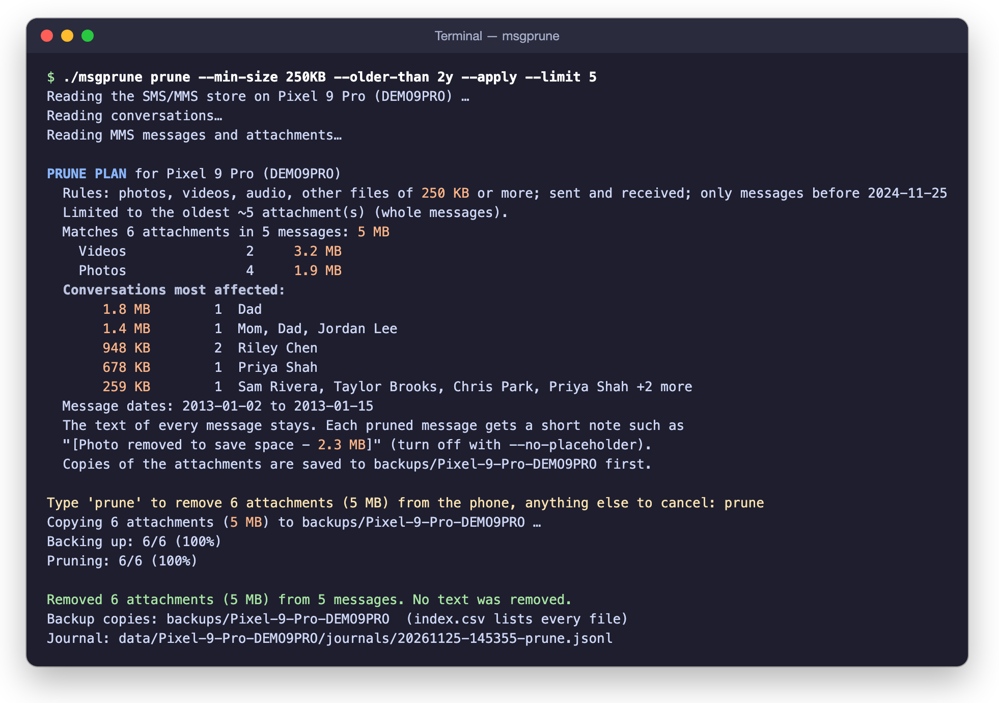
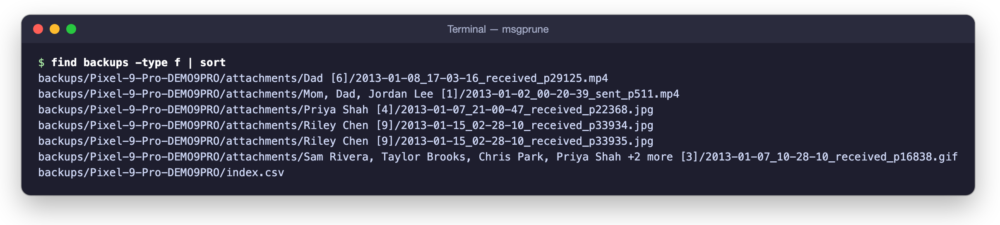

# msgprune

**Free up space on your Android phone by removing old photos and videos from your text messages, without losing a single word of the conversations.**

[](https://github.com/NessDan/android-messages-pruning/actions/workflows/tests.yml)


[](LICENSE)

<p align="center">
  
</p>

Years of picture messages can quietly fill a phone. Android has no "delete the old attachments
but keep my texts" button. **msgprune is that button.** It runs on your computer, talks to the
phone over a USB cable, shows you exactly where the space goes, and removes the attachments
you pick. It saves a copy of each one on your computer first.

- 🔍 **See where the space goes:** by conversation, year, file type and size.
- 🧹 **Remove attachments, keep the text:** choose by size, age, type and conversation.
- 💾 **Backs up first:** every file is copied to your computer and checked before it leaves the phone.
- 🛡️ **Careful by default:** it only previews unless you add `--apply`, asks you to type `prune`, and tests the first change before doing more.
- 📱 **Nothing to install on the phone:** no app, no root. Just USB debugging.

> The screenshots on this page come from msgprune's built-in **demo phone** (made-up names and
> numbers), so you can see exactly what you'll get before plugging anything in.

> [!IMPORTANT]
> **Early release.** msgprune is tested end to end against a simulated phone, but it hasn't
> been run on many real phones yet. Start with `--limit 5`, check the result on the phone, and
> keep a backup. [Reports from real phones](https://github.com/NessDan/android-messages-pruning/issues) are very welcome.

## Contents

- [What it can and can't remove](#what-it-can-and-cant-remove)
- [Install](#install)
- [Walkthrough](#walkthrough)
- [Options](#options)
- [What Google Messages shows afterwards](#what-google-messages-shows-afterwards)
- [Clearing RCS photos and videos](#clearing-rcs-photos-and-videos)
- [Safety](#safety)
- [FAQ](#faq)
- [How it works under the hood](#how-it-works-under-the-hood)
- [Development](#development)

## What it can and can't remove

Your message history lives in **two places** on the phone, and that decides what any tool can do:

<p align="center">
  
</p>

| Message type | What it is | Can msgprune remove its attachments? |
|---|---|---|
| **SMS** | Plain texts | Nothing to remove: text only, tiny |
| **MMS** | Picture/video/group messages sent through your carrier: older chats, and group chats with iPhones before iOS 18 | ✅ **Yes.** The attachment goes, the text stays |
| **RCS** | "Chat features" in Google Messages: full-quality photos/videos, typing dots, read receipts | ❌ **No.** Only Google Messages can delete these ([here's how](#clearing-rcs-photos-and-videos)) |

`./msgprune scan` shows how *your* phone splits between the two, so you know which part of
this page matters to you.

## Install

You need a Mac or Linux computer with Python 3.9+ (macOS already has it) and a USB cable
that carries data.

**1. Install adb**, Android's USB debugging tool:

```bash
brew install --cask android-platform-tools
```

(On Debian/Ubuntu: `sudo apt install adb`.)

**2. Download msgprune:**

```bash
git clone https://github.com/NessDan/android-messages-pruning.git
cd android-messages-pruning
```

There's nothing else to install: no `pip`, no packages.

**3. Turn on USB debugging** on the phone:

1. **Settings > About phone**: tap **Build number** 7 times until it says you're a developer.
2. **Settings > System > Developer options**: turn on **USB debugging**.
3. Plug the phone into your computer, unlock it, and tap **Allow** on *"Allow USB debugging?"*.

## Walkthrough

### 1. Check the setup

```bash
./msgprune doctor
```



`doctor` only reads. Fix anything marked `FAIL` before going on.

### 2. See where the space goes

```bash
./msgprune scan
```

This is the report at the top of this page. It splits the space between Google Messages' own
storage and the SMS/MMS store, then breaks the MMS attachments down by type, size,
conversation and year. It also shows how much each `--min-size` choice would free. The first
scan measures every attachment, which can take several minutes for tens of thousands of them.
Later scans are fast.

<details>
<summary><b>Show the full scan report</b></summary>
<br>

</details>

### 3. Preview a prune (changes nothing)

```bash
./msgprune prune --min-size 250KB --older-than 2y
```



Without `--apply`, `prune` only shows what it *would* do.

### 4. Do it, a few at a time first

```bash
./msgprune prune --min-size 250KB --older-than 2y --apply --limit 5
```



`--limit 5` handles the 5 oldest matching attachments. Look at those messages on the phone
(the dates are in the output). Then run the same command without `--limit` for the rest. If
anything interrupts a run, run the same command again and it continues where it stopped.

### 5. Your backups

Every removed attachment is saved under `backups/`, in one folder per conversation. Files are
named by the message's date, and each file's date is set to when the message was sent.
`index.csv` lists them all.



## Options

All of these work in preview mode too.

| Option | What it does |
|---|---|
| `--min-size 500KB` | Only attachments at least this big. Default `100KB`. Carriers cap MMS at roughly 0.3–3 MB, so 100KB catches nearly every real photo. |
| `--types image,video` | Which kinds: `image`, `video`, `audio`, `other`. Default: all four. |
| `--older-than 1y` | Only messages older than this: `90d`, `12w`, `6mo`, `2y`, or a date like `2024-01-31`. |
| `--skip "Mom"` | Leave conversations matching a name or number alone. Can be repeated. |
| `--only "555-0101"` | Only conversations matching a name or number. Can be repeated. |
| `--limit 5` | Stop after about this many attachments, oldest first. |
| `--backup-dir /Volumes/USB/msgs` | Where the copies go. Default `./backups/<phone>`. |
| `--no-backup` | Don't copy to the computer first. Only if you have another full backup. |
| `--no-placeholder` | Don't add the `[Photo removed …]` note to pruned messages. |
| `--device "Pixel 9"` | Which phone, if more than one is plugged in (see `./msgprune devices`). |

Long runs: keep a Mac awake with `caffeinate -i ./msgprune prune …`.

## What Google Messages shows afterwards

Every message keeps its text. msgprune also adds a short note to each pruned message, like
`[Photo removed to save space - 2.3 MB]`.

Google Messages keeps its own copy of your message list and doesn't re-read messages it
already knows about. So **in the app**, a pruned picture will most likely show up as an empty
or "couldn't load" tile next to the text, and the note may not appear. The note is stored in
Android's SMS/MMS store, so it shows up wherever that store is read fresh: backup apps,
exports, and your next phone.

That's the main reason to start with `--limit 5`: see what your phone does before pruning
thousands.

## Clearing RCS photos and videos

RCS media lives inside Google Messages' private storage, and Android only lets Google
Messages itself delete it. If `scan` shows most of your space is in Google Messages' own
storage, this is the part that matters:

1. **Look for Google's storage manager.** Google has been building a "Manage space" screen
   into Messages for clearing old media without losing conversations. It was found in beta
   builds in August 2026. Check **Settings > Apps > Messages > Storage & cache**. If the button
   says **Manage space** instead of "Clear storage", tap it.
2. **Delete media, not conversations.** In RCS every photo and video is its own message,
   separate from the text around it, so deleting them never removes any text.
   - The search screen in Google Messages has **Images** and **Videos** filters that show media
     from every conversation. Start with **Videos**: they're the big ones.
   - Inside a conversation, long-press a photo or video, tap others to select them too, then delete.
3. **Empty the Trash.** Recent versions of Messages keep deleted items in a Trash folder for
   30 days, and you only get the space back once it's emptied.

## Safety

msgprune changes things on the phone only when you run `prune --apply` and confirm. Then:

- **Text is never a candidate.** Message text and the MMS layout part are always kept. Drafts,
  unsent and failed messages are never touched.
- **Copy first.** Each attachment is copied to your computer and checked (size + SHA-256)
  before removal. If a copy fails, that attachment stays on the phone.
- **One item at a time.** Every change names exactly one attachment or message. There are no
  bulk "delete where…" commands that a mistake could widen.
- **Tests the first change.** The first message is done on its own and verified. If the phone
  silently ignored the change (that's how Android refuses), msgprune stops there.
- **Permission is temporary.** Normally only your default SMS app can change messages.
  msgprune turns on the adb shell's permission (`WRITE_SMS`) for the length of the run, then
  puts back whatever was there before, even if you press Ctrl-C.
- **Journal.** Everything it does is written to `data/<phone>/journals/*.jsonl` as it happens.

**If you're moving to a new phone:** let the transfer copy everything, prune the *new* phone,
and keep the old phone untouched until you're happy with the result.

## FAQ

**Do I need to root the phone?** No. It uses USB debugging and Android's built-in `content`
tool.

**Will it delete my texts?** No. Only attachments that match your filters are removed. The
text in the same message stays.

**Can I undo it?** The removed files are in `backups/`, listed in `index.csv`, so you can open
or keep them. Putting them back into the phone isn't automated yet.

**Which phones work?** It uses standard Android commands, so it should work on most Android
phones with USB debugging. It was built for Google Messages on Pixel. Samsung Messages keeps
RCS chats in its own storage too, so the same MMS-only rule applies.

**Windows?** Untested. The Python code should run with `python -m msgprune` (with `src` on
`PYTHONPATH`) or inside WSL.

**Where's my data going?** Nowhere. Everything stays between your phone and your computer.
msgprune never connects to the internet.

## How it works under the hood

Everything goes through `adb shell` and Android's own command-line tools:

| Step | Command on the phone |
|---|---|
| List conversations, messages, attachments | `content query --uri content://mms-sms/conversations?simple=true`, `content://mms`, `content://mms/part` |
| Name conversations | `content query --uri content://com.android.contacts/data/phones` |
| Measure each attachment (on the phone, nothing crosses the cable) | `content read --uri content://mms/part/<id> \| wc -c`, several at a time |
| Copy an attachment to the computer | `content read --uri content://mms/part/<id>` |
| Storage numbers per app | `dumpsys diskstats` (Android refreshes it about once a day) |
| Allow writes for the run, then restore | `appops set com.android.shell WRITE_SMS allow` / previous mode |
| Add the note | `content insert --uri content://mms/<message>/part --bind ct:s:text/plain --bind text:s:…` |
| Remove an attachment | `content delete --uri content://mms/part/<id>` |

Every write is checked by reading back, because Android doesn't report refused writes as errors.

## Development

```bash
python3 -m unittest discover -s tests -v      # 19 tests, about 30 seconds
```

The tests run the real CLI against a **fake phone**: a stand-in `adb` (`tests/fakephone/adb`)
backed by a SQLite copy of Android's SMS/MMS tables. It behaves like Android where it matters
for safety. For example, writes are silently ignored until the `WRITE_SMS` app-op is allowed,
and there are switches to simulate a phone that refuses.

Try the whole thing without a phone, using the demo phone from the screenshots:

```bash
python3 tests/fakephone/demo.py /tmp/demo-phone
export FAKEPHONE_ROOT=/tmp/demo-phone MSGPRUNE_ADB=$PWD/tests/fakephone/adb \
       FAKEPHONE_MODEL=Pixel_9_Pro FAKEPHONE_SERIAL=DEMO9PRO
./msgprune scan
```

Regenerate the screenshots (needs Google Chrome): `python3 docs/screenshots/make_screenshots.py`.

Issues and pull requests are welcome, especially reports from real phones: model, Android
version, and what Google Messages showed after a `--limit 5` run.

## License

[MIT](LICENSE). msgprune is an independent project and isn't affiliated with Google.
